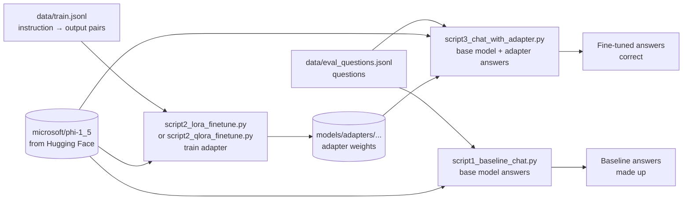

# Fine-tuning phi-1.5 with LoRA and QLoRA

Teach a small pre-trained language model (`microsoft/phi-1_5`, 1.4B parameters) two facts it can't know, using parameter-efficient fine-tuning. The base model stays frozen; training only adds a small **adapter** (a few MB) on top of it.

The project shows the full before → train → after loop:

1. Ask the **base model** the questions: it has never seen the facts, so it makes something up.
2. **Fine-tune** a LoRA adapter on the facts (or a QLoRA adapter on a 4-bit model).
3. Ask the **base model + adapter** the same questions: it now answers correctly.

## Program flow



All three scripts follow the same pattern: **load the tokenizer and base model → prepare text in a fixed prompt format → run the model (generate or train) → print or save the result.**

## The scripts, step by step

### 1. `script1_baseline_chat.py`: the "before"

1. Read the questions from `data/eval_questions.jsonl`.
2. Load the tokenizer and `microsoft/phi-1_5` (downloaded once, then cached in `~/.cache/huggingface`).
3. For each question, build the prompt `Questions: <question>\nAnswer:`.
4. Generate up to 80 new tokens with greedy decoding (`do_sample=False`) and print the full output.

Expected result: a confident but invented answer, often followed by more made-up "Exercise" questions, because a base model continues text rather than answering.

### 2a. `script2_lora_finetune.py`: train a LoRA adapter (runs on CPU)

1. **Load** the tokenizer and base model in `float32`. The tokenizer has no padding token, so the end-of-text token is reused as one.
2. **Load the data** from `data/train.jsonl` with `datasets.load_dataset("json", ...)`.
3. **Tokenise** each example as `Instruction: <instruction>\n Response: <output>`, padded and truncated to 128 tokens, with `labels` = `input_ids` (the model learns to predict the next token).
4. **Wrap the model with LoRA** (`peft.get_peft_model`): rank `r=8`, `lora_alpha=128`, dropout 0.05. Only the small adapter matrices are trainable (about 0.3% of the parameters); the base weights stay frozen.
5. **Train** with the Hugging Face `Trainer`: 40 epochs, batch size 1, gradient accumulation 4, learning rate 2e-4. `DataCollatorForLanguageModeling(mlm=False)` builds the batches and masks padding out of the loss.
6. **Save** only the adapter to `models/adapters/lora_adapt/` (`adapter_model.safetensors` + `adapter_config.json`).

### 2b. `script2_qlora_finetune.py`: train a QLoRA adapter (needs an NVIDIA GPU)

Same steps as 2a, except:

- **Step 1** loads the base model **quantised to 4-bit** with `BitsAndBytesConfig(load_in_4bit=True, bnb_4bit_use_double_quant=True, bnb_4bit_compute_dtype=torch.float16)`. The model then needs roughly 1 GB instead of 5.7 GB, which is the point of QLoRA.
- It trains for 30 epochs and saves to `models/adapters/qlora_acme/`.
- The prompt has no space before `Response:`.

`bitsandbytes` 4-bit loading needs CUDA, so this script runs on a GPU machine (I ran it on Kaggle; see [`script2-qlora-finetune.ipynb`](script2-qlora-finetune.ipynb)). On a GPU, set `device_map={"": 0}` instead of `"cpu"`.

### 3. `script3_chat_with_adapter.py`: the "after"

1. Load the tokenizer and the base model again.
2. **Attach the trained adapter** with `PeftModel.from_pretrained(base_model, ADAPTER_PATH)`. The adapter stays separate (not merged), so the same base model can be paired with different adapters.
3. Switch to evaluation mode (`model.eval()`).
4. For each question, build the prompt in the **training format**, `Instruction: <question>\nResponse:`, and generate up to 50 new tokens greedily.
5. `clean_answer()` strips the echoed prompt and keeps only the first line of the reply, since the model keeps generating after the answer.

To chat with the QLoRA adapter instead, set `ADAPTER_PATH = "models/adapters/qlora_acme"` and load the base model in 4-bit on the GPU, as in step 2b.

## Folder layout

| Path | What it is |
|---|---|
| `data/train.jsonl` | Training examples: one JSON object per line, `{"instruction": "...", "output": "..."}` |
| `data/eval_questions.jsonl` | Evaluation questions: `{"question": "..."}` per line |
| `models/adapters/` | Trained adapters are saved here (`lora_adapt/` is committed; it's 15.7 MB) |
| `models/base/` | Placeholder; the base model is cached by Hugging Face instead |
| `script1_…`, `script2_…`, `script3_…` | The scripts above |
| `script2-qlora-finetune.ipynb` | The Kaggle notebook used for the QLoRA run, with its outputs |
| `template.py` | Creates this folder structure with empty files |
| `ISSUES_AND_FIXES.md` | Every setup and code problem hit while getting this to run, with fixes |

## How to run

Use **Python 3.11**: the pinned versions in `requirements.txt` have no packages for newer Python (details in [ISSUES_AND_FIXES.md](ISSUES_AND_FIXES.md)).

```bash
uv venv .venv --python 3.11 --prompt finetuning --seed
source .venv/bin/activate

# CPU-only machine: install the CPU build of torch (skips ~2–3 GB of CUDA libraries)
pip install -r requirements.txt --extra-index-url https://download.pytorch.org/whl/cpu
# GPU machine: pip install -r requirements.txt

python script1_baseline_chat.py      # before
python script2_lora_finetune.py      # train (≈ 7 min on a laptop CPU)
python script3_chat_with_adapter.py  # after
```

The first run downloads the base model (2.84 GB). The `float32` model needs about 6 GB of free RAM.

## Results

On a laptop CPU, LoRA training took about 7 minutes (40 steps at ≈ 10.5 s each), and the loss fell from 2.24 to 0.014. On a Kaggle T4 GPU, QLoRA training took 15 seconds. Before fine-tuning, the base model made up both answers; afterwards, both the LoRA and QLoRA adapters gave both trained facts correctly.

With only two training examples, the adapter **memorises** them rather than learning anything general. That's enough to demonstrate the technique, not to build a useful model.

## Known issues

[ISSUES_AND_FIXES.md](ISSUES_AND_FIXES.md) has the full list. The ones that affect running the scripts as they are:

- `target_modules=["Wqkv", "out_proj", "fc1", "fc2"]` in both training scripts: `Wqkv` and `out_proj` don't exist in phi-1.5 under `transformers` 4.39.3, so only the feed-forward layers (`fc1`, `fc2`) get adapters. To include attention, use `["q_proj", "k_proj", "v_proj", "dense", "fc1", "fc2"]` (as in the Kaggle QLoRA run).
- The LoRA training prompt has a space before `Response:` and the chat prompt doesn't. It still worked here, but the two prompts should match exactly.
